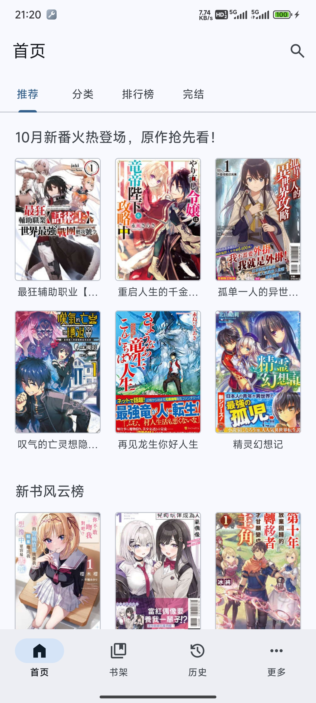
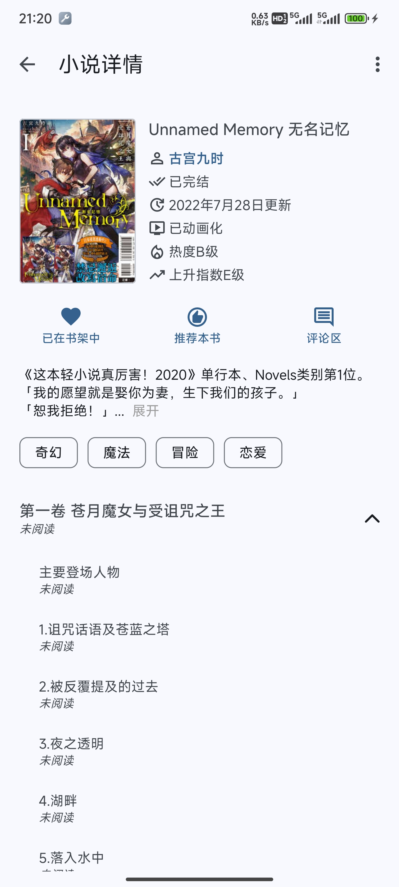
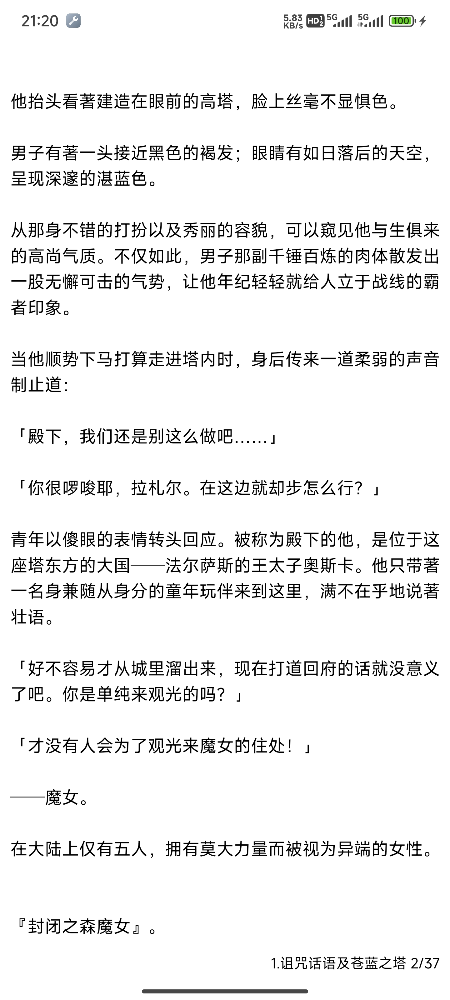
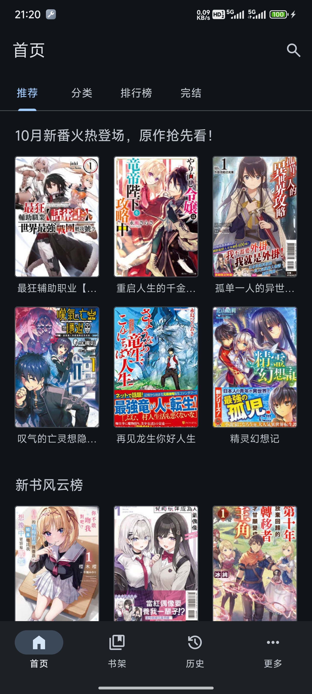
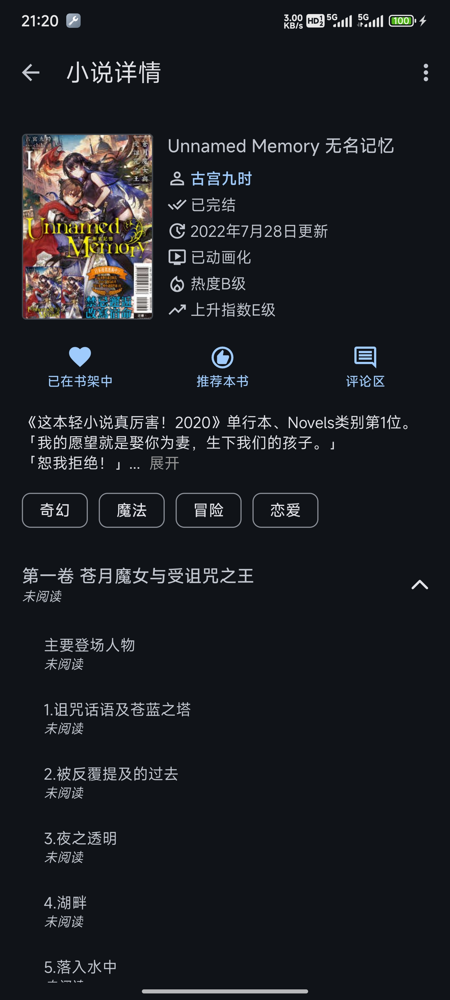
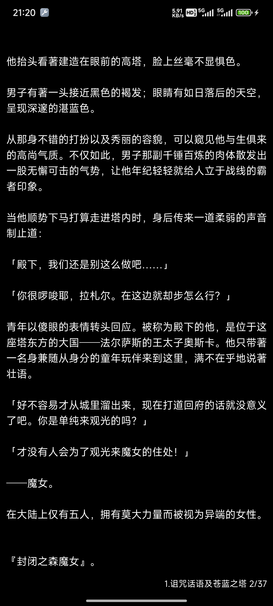

<div align="center">

  

  # Hikari Novel

  <div>
    
    
  </div>

  <p align="center"><font>第三方轻小说文库客户端，使用MD3风格，更简洁，更清爽</font></p>

</div>

> [!WARNING]\
> 本软件目前只适配了手机，未适配平板，不建议平板使用本软件！

> [!IMPORTANT]\
> 本软件是轻小说文库的第三方客户端，与轻小说文库官方无关，本软件数据全部来自[轻小说文库](https://www.wenku8.cc)以及[light-novel-library_Wenku8_Android](https://github.com/MewX/light-novel-library_Wenku8_Android)\
> 支持的安卓版本：Android 7+ (API 24+)

> [!NOTE]\
> 觉得好用别忘了 star 哦，你的 star 是对作者最大的激励

<hr>

## 本项目是归档仓库的 fork，正在持续维护

本仓库 fork 自**已归档停止更新的上游项目** [15dd/wenku8reader](https://github.com/15dd/wenku8reader)。上游作者已在原始 README 中声明永久停更，因此本 fork 承接后续维护。

**当前维护目标：稳定性优先 + 文档补齐**，而不是追加新功能。也就是说：

- 修复崩溃、数据安全、进度丢失等稳定性问题；
- 让仓库中的文档与代码实际状态对齐（架构现状、迁移契约、验证入口）；
- 上游遗留的技术债（阅读器重构、依赖升级）按计划逐步收敛。

> [!NOTE]
> 上游曾提示"本软件已无法正常使用"，原因是上游停止维护后站点接口与边缘策略变动，请求被 Cloudflare 拦下。
> 本 fork 已修复登录、详情页与书架的主流程（见下方「站点可用性修复」），并会持续跟进站点变化。
> 站点策略随时可能再次变动，本 fork 不承诺任何时段内的可用性。

### 相关项目

- 上游原仓库（已归档）：[15dd/wenku8reader](https://github.com/15dd/wenku8reader)
- 上游作者的 Flutter 重构版（仅供有能力自行编译者参考，无安装包）：[hikari_novel_flutter](https://github.com/15dd/hikari_novel_flutter)
- 另一个可选客户端：[light-novel-library_Wenku8_Android](https://github.com/MewX/light-novel-library_Wenku8_Android)

<hr>

## 阅读器核心重构状态（fork 维护进度）

本 fork 按 [阅读核心重构计划](./docs/plan/reader-core-refactor-plan.md) 推进阅读核心渐进式重构。各阶段在**源码层面**的落地情况：

| 阶段 | 内容 | 当前状态 |
| --- | --- | --- |
| 一 | 行为基线与 JVM fixture | 已落地，见 [阅读器行为基线](./docs/reader-behavior-baseline.md) |
| 二 | 统一阅读领域模型 | 已落地（`ChapterRef` / `CachedChapter` / `ReaderAnchor`） |
| 三 | 拆出 `ChapterCache`、`ChapterLoader`、`ReaderProgressStore`、`ChapterPrefetcher` | 已落地 |
| 四 | 横向 / 竖向数据源边界统一 | 已落地 |
| 五 | 收敛横竖 ViewModel | 已落地：`ReaderSessionCoordinator` 由横竖两个 `ReadViewModel` 共用 |
| 六 | 数据库兼容与 `(aid, cid)` 迁移 | 已落地：`reader_data` v1→v4、横竖历史表 v1→2，schema 已导出至 `app/schemas/` |
| 七 | 灰度验证与性能清单 | **清单已建立，设备与性能测试未完成**，见 [阶段七验证清单](./docs/reader-validation-phase7.md) |

阅读进度以 `ReaderAnchor` 为新模型，旧横向/竖向历史通过非破坏性迁移保留并以惰性回退方式读取；详见 [阶段六迁移契约](./docs/reader-data-migration-phase6.md)。已知遗留重构项是 `ReaderRepository` 仍保留下载编排门面，见 [当前问题清单](./docs/reader-issues.md)。

> [!NOTE]
> 上表描述的是**源码实现状态**。构建与单元测试已在本机通过，但阶段七的设备、
> Room migration 与性能回归仍未执行。

## 站点可用性修复

上游停更后站点换了 Cloudflare 边缘策略，登录、详情页、书架相继失效。这些是客户端
自身可适配的规则，已逐条实测并修复；完整推导见
[登录站点可用性修复方案](./docs/plan/login-site-availability-plan.md) 与
[稳定性收尾方案](./docs/plan/app-stability-followup-plan.md)。

### 请求侧规则

站点只放行官方 App 的请求特征，以下四条缺一不可（均以 `www.wenku8.net` 实测）：

| 规则 | 现象 | 处理 |
| --- | --- | --- |
| `User-Agent` | 官方 Dalvik 标识返回 `200`；Chrome / WebView / curl 一律被质询 | 统一使用官方 App 的 UA |
| `Accept-Encoding` | 带 `gzip` 返回 `403`；`identity` 返回 `200` | 对两个 web 节点强制 `identity` |
| 查询串含小写 `charset` | 字面量 `charset=` 被 WAF 拦（`403`），大小写敏感的子串匹配 | 参数名改写为 `ch%61rset`，服务端仍按 GBK/BIG5 输出 |
| `reader.php` 的 `Referer` | 无 `Referer` 返回质询，带同站 `Referer` 返回 `200` | 默认补同站根 `Referer` |

对应实现集中在
[`Wenku8Headers`](./app/src/main/java/com/cyh128/hikari_novel/data/source/remote/Wenku8Headers.kt)、
[`Wenku8WebUrls`](./app/src/main/java/com/cyh128/hikari_novel/data/source/remote/Wenku8WebUrls.kt)
与 `HikariApp.Wenku8WebHeadersInterceptor`，URL 规则为纯函数并有单测覆盖。

### 客户端侧修复

- **登录不再多等 4~5 秒**：原来要等六个书架页全部返回才进主界面。实测
  `login.php` 约 1.2 s、六个书架页并发约 2.6 s，等待全部来自客户端流程。
  现在登录成功即进主界面，书架同步交给应用级作用域在后台完成。
- **书架同步不再丢数据**：原先「先清空本地表、再逐个请求」，任一步失败书架就空了。
  现改为拿到响应后单事务替换，部分成功也保留。
- **同步失败不再卡死界面**：进度对话框不可取消，但失败分支此前没有关闭它。
- **更新检查不再误报**：接口原先指向已归档的上游仓库，其最新 tag 是 `bye`（停更通知），
  配合字符串比较等于每次启动都提示更新。现改为本 fork 的 releases 并按数值比较版本号。
- **修掉一个启动崩溃循环**：MMKV 中的枚举 ordinal 越界会抛异常，且发生在崩溃拦截器
  安装之前，用户无法自恢复。现安全回退到默认值。

### 关于插图域名

正文插图返回的 `pic.777743.xyz` **是站点自己的图床**，不是客户端改写的结果：

```
GET https://pic.777743.xyz/3/3825/172100/212103.jpg  -> 200 image/jpeg
GET https://img.wenku8.com/3/3825/172100/212103.jpg  -> 302 -> /deny.txt -> 403
```

同一路径换回 `img.wenku8.com` 反而拿不到图，因此保留站点返回值不做替换。

## Bug Fixes & Stability

### 本 fork 已完成的改动

- **阅读器阶段五：收敛横向与竖向 ViewModel**。横竖两个 `ReadViewModel` 现在共用 `ReaderSessionCoordinator`（[ReaderSessionCoordinator.kt](./app/src/main/java/com/cyh128/hikari_novel/reader/domain/ReaderSessionCoordinator.kt)）：章节导航、加载代次（generation，用于丢弃快速跳章时的旧响应）、预取、锚点存取等公共逻辑收敛为一份实现；横向分页状态、竖向滚动状态、手势与渲染策略仍各自保留。对应 [重构计划阶段五](./docs/plan/reader-core-refactor-plan.md) 的验收标准。

  - **与重构计划原建议的偏离（有意改良）**：计划建议构造参数为 `(repository, navigator, progressStore)`，实际实现改为单一的 `ReaderSessionDataSource` 边界接口。该接口暴露 storage-neutral 的 `ReaderProgressSnapshot`，使 coordinator 不依赖 Room / Android 类，从而可在纯 JVM 下测试。
  - `ReaderSessionModule` 未标注 `@Singleton`，因此每个注入点获得独立实例，符合"每个 ViewModel 一个会话"的设计意图。

### 尚未处理的已知问题（上游遗留，本 fork 暂未修复）

以下问题在当前工作树中**仍然存在**。它们已通过源码审计确认，但尚未修正——本 fork 以稳定性为优先，按计划逐步处理：

| 类别 | 问题 | 位置 |
| --- | --- | --- |
| 安全 | TLS 主机名校验被全局关闭（`.hostnameVerifier { _, _ -> true }`），任意无效证书均被接受，登录凭据存在中间人风险 | `HikariApp.kt` |
| 安全 | 签名密钥 `app/src/key.jks` 与弱密码硬编码进版本库，且 debug / release 共用同一签名配置 | `app/build.gradle.kts` |
| 安全 | `usesCleartextTraffic="true"` 放行明文流量，登录接口走 `http://app.wenku8.com` | `AndroidManifest.xml` / `Network.kt` |
| 发布 | `targetSdk = 34`（注释说明为保留 edgeToEdge 而刻意未升），已低于 Google Play 的 35+ 要求 | `app/build.gradle.kts` |

此前表中记录的「枚举反序列化越界」「更新检查误判」「正文图片被重写到第三方域名」三条
均已处理或证伪，结论见上方[站点可用性修复](#站点可用性修复)。

### 发布状态

本 fork 尚未发布 release 或 tag，上述改动目前仅存在于源码。`assembleRelease` 已可产出
签名 APK（`versionName 3.9.11`，`versionCode 261014`），发布前仍需完成阶段七的设备与
性能验证。

### 构建与测试

在可访问 Google/Maven Central/JitPack 依赖的环境中执行：

    .\gradlew.bat :app:testDebugUnitTest --no-daemon
    .\gradlew.bat :app:compileDebugKotlin --no-daemon
    .\gradlew.bat :app:connectedDebugAndroidTest --no-daemon

当前验证状态：`testDebugUnitTest`（204 个用例）、`compileDebugKotlin`、`assembleDebug` 与 `assembleRelease` 均已在本机通过。设备测试（`connectedDebugAndroidTest`）尚未执行，因为没有可用的真机或模拟器。

## 软件截图
- 浅色模式
<div align="center">
  </img> </img> 
</div>

<br>

- 深色模式
<div align="center">
  </img> </img> 
</div>

## 作者的闲话（上游原作者自述）

> 以下内容为上游项目原作者的自述，fork 予以保留以尊重创作历程。

  说起来你们可能不信，这软件是我一个中专生写的（刚开始写软件的时候还是中专生，现在已经是大专生了），我的编程技术不好，这一点是可以从源代码中看出来的。
  <br>
  <br>
  这个软件是我在23年3月开始写的，然后第一次接触了Android开发，中间就是边学边做。一放学就马上跑回家坐在电脑面前，不断地完善代码、看教程、查文档。虽然遇到不懂的地方还挺头疼的，但是总体过程还是挺开心的。历时两个月，我写出了第一个正式版，我都没想到我可以做出一个App，并且把我当时想要实现的功能全都做出来了，内心很是激动。在第一个版本发布之后，我继续学习相关知识，不断优化软件，解决大家在使用软件中的问题，然后继续发布更新至今。
  <br>
  <br>
  现在的v3大版本已经是经过一次大重构了，代码质量明显比之前好了，但还需要改进

## Stargazers over time
[](https://starchart.cc/Xiaoqi2145/wenku8reader)
